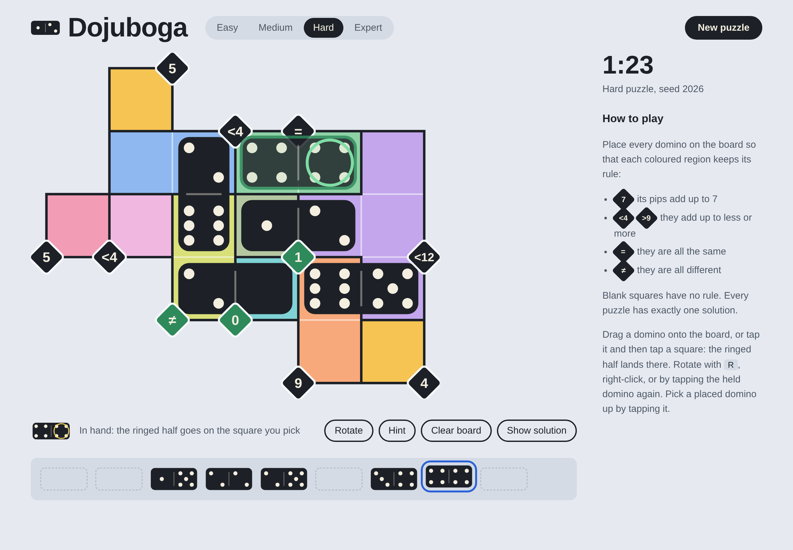

# DojubogaWeb

A browser front end for [Dojuboga](https://github.com/cjwinstead/Dojuboga.jl),
the domino-placement puzzle with unique solutions and rated difficulty.



One page, two ways to run it:

- **Local:** a small web server on your own machine generates every new
  puzzle on demand. Unlimited puzzles, and it works offline.
- **Static site:** a folder with the page and pre-generated puzzle packs that
  any static host can serve, such as GitHub Pages. No Julia needed to play.
  It's also an installable app: put it on a phone's home screen and it plays
  offline.

It is built only on Dojuboga's public front-end API and Julia's standard
library, so there is nothing else to install.

## Install

Requires Julia 1.10 or later. Both packages are in the
[LEFT_registry](https://github.com/cjwinstead/LEFT_registry):

```julia
pkg> registry add https://github.com/cjwinstead/LEFT_registry
pkg> add DojubogaWeb
```

## Play locally

```julia
using DojubogaWeb
serve()                 # opens http://localhost:8000/ in your browser; Ctrl-C to stop
serve(port = 8080)      # another port
```

The server listens on your own computer only (127.0.0.1), so nobody else
on the network can reach it.

## Publish a static site

```julia
using DojubogaWeb
export_site("site")                      # 200 puzzles per level, about 1 MB
export_site("site"; per_level = 500)     # more puzzles
serve(site = "site")                     # preview it exactly as a static host would
```

Puzzle `k` of each level is generated from seed `k`, so the same call always
produces the same site.

To put it on GitHub Pages, for example in a repository `dojuboga-play`:

```bash
cd site
git init -b main && git add -A && git commit -m "Dojuboga puzzles"
gh repo create cjwinstead/dojuboga-play --public --source=. --remote=origin --push
gh api -X POST repos/cjwinstead/dojuboga-play/pages -f "source[branch]=main" -f "source[path]=/"
```

The site then appears at `https://cjwinstead.github.io/dojuboga-play/`
after a minute or two.

## Install it on a phone

A site published with `export_site` on an HTTPS host (GitHub Pages is HTTPS)
installs like an app, with its own icon and full-screen window, and plays
without a connection:

- **Android (Chrome):** open the site and choose **Install app**, either from
  the page's own button or from the browser menu.
- **iPhone and iPad (Safari):** open the site, tap **Share**, then
  **Add to Home Screen**. The page shows this tip once; the × hides it.
- **Desktop Chrome or Edge:** the page shows an **Install app** button.

The first visit saves the page and all puzzle packs (about 1.2 MB with the
default 200 puzzles per level) on the device. The page then says "Saved on this
device, so it plays without a connection." When you publish a changed site,
installed copies pick it up on their next visit with a connection. If a phone
ever clears the saved copy, the app downloads it again the next time it's
online.

These parts make it work, and `export_site` writes all of them:
`manifest.webmanifest` (name, colours, icons), `icons/`, and `sw.js` (a service
worker that keeps the files on the device). The service worker's version is a
fingerprint of the site's files, so any re-export with different puzzles or a
newer page replaces the old copy.

Opening `index.html` straight from disk (a `file://` address) won't work,
because browsers block a local page from loading its own puzzle packs. Use
`serve(site = …)` or a real host.

## Playing

- **Mouse or touch:** drag a domino onto the board, or tap it and then tap a
  square. The ringed half lands on that square. Tap the held domino again,
  press `R`, right-click or use the Rotate button to turn it. Tap a placed
  domino to pick it up; right-click it to send it back to the tray.
- **Keyboard:** Tab to a domino and press Enter to take it (Enter again
  rotates), then Tab to the board, move with the arrow keys and press Enter
  to place it. `R` rotates, `Esc` puts it back, `H` gives a hint, `N` starts
  a new puzzle.
- Each rule badge turns green when its region is full and correct, and red
  when it's full and wrong.
- The address bar holds the puzzle (`#hard-4242`), so you can bookmark or
  share a puzzle. Locally the number is the seed; on a static site it is the
  puzzle's place in the pack.

## Puzzle JSON format

`GET /api/new?level=hard&seed=4242` (local mode) returns one puzzle, and
`puzzles/<level>.json` (static mode) holds
`{"format": "dojuboga-pack", "version": 1, "level": …, "puzzles": [ … ]}`.
`puzzle_json(level; seed)` produces the same thing from Julia. All indices and
coordinates are **0-based**:

```jsonc
{
  "format": "dojuboga-puzzle", "version": 1,
  "level": "hard",                    // requested level
  "seed": "4242",                     // a string: seeds can exceed 2^53
  "rating": {"score": 41.0, "level": "hard"},
  "rows": 7, "cols": 5,               // bounding box
  "cells": [[0, 2], [1, 2], …],       // cell i is at [row, col]
  "regions": [{
      "cells": [0, 1, 2],             // cell indices
      "rule": {"kind": "sum", "k": 10},   // kind: sum | less | greater | equal | notequal | none
      "label": "10",                  // display text: "10", "<4", ">9", "=", "≠", "" for none
      "ruleCell": 2,                  // Dojuboga's suggested badge cell
      "color": 5                      // 1–10, neighbours differ; 0 for blank regions
  }, …],
  "dominoes": [[0, 3], [1, 5], …],    // domino d has halves [a, b], a ≤ b
  "solution": [{"domino": 0, "a": 4, "b": 5}, …]   // cell for half a and for half b
}
```

The server also answers `GET /api/info.json` with
`{"mode": "local", "levels": […], "engine": "0.1.0", "format": 1}`. An
exported site contains a static `api/info.json` with `"mode": "static"`.

## Julia API

| Function | |
|---|---|
| `serve(; port = 8000, site = nothing, open_browser = true, block = true)` | Run the server. Pass `site` to serve an exported folder instead of the engine. With `block = false` it returns the server; `close` it to stop. |
| `export_site(dir; per_level = 200, levels = LEVELS, first_seed = 1)` | Write a static site. |
| `puzzle_json(game)`, `puzzle_json(level; seed)` | One puzzle in the format above. |

## License

MIT, see [LICENSE](LICENSE). Inspired by *Pips* from The New York Times
Games; Dojuboga is an independent project.
